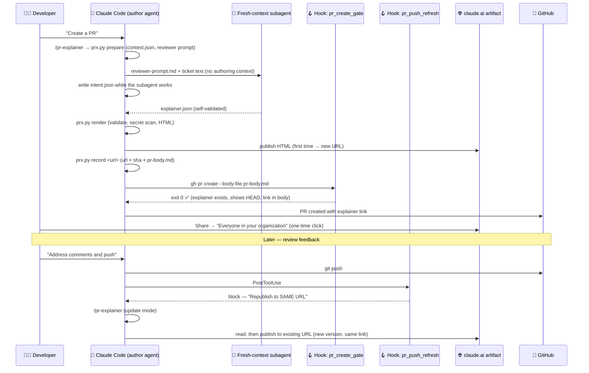

# 🧭 PR Explainer — Reference & Implementation Plan

> **Purpose of this document:** a complete reference for Claude Code to build a "PR Explainer" workflow. Every time the agent creates a PR, it generates an **interactive HTML explainer page**, publishes it as a **Claude Code artifact**, and puts the link in the PR description. Two Claude Code hooks enforce this on `gh pr create` and refresh it on `git push`.
>
> **Scope:** personal use first (one engineer, everyone assumed to be on Claude Code). No CI, no GitHub Action, no custom hosting.
>
> **Status (2026-10-09):** Phase 1 is built and dogfooded: [PR #1](https://github.com/limittox/pr-explainer/pull/1) was opened through the gate with its own explainer, eight explainer versions were published to the same URL as fixes landed, and the reviewer's findings are logged in §11.1. Native Mermaid rendering in the published artifact is confirmed. Still open: an org colleague opening a shared page.

---

## 1. 🧩 Problem statement

- Most code is now written by agents. Engineers rarely open IDEs or read code directly.
- Reviewers (especially senior engineers) can't read PRs touching thousands of files and lines.
- Reviewers rely on PR descriptions, but those are often:
  - too long and hard to digest
  - unclear about what actually changed and why
  - lacking diagrams and visual structure
  - boring, which leads to **rubber-stamp approvals**
- Industry data backs this up:
  - A 2026 study of 930k+ GitHub PRs found ~61% of AI-agent PRs got no review at all.
  - Reviewer habituation research shows reviewers become measurably more lenient over repeated agent-PR reviews.

**Goal:** make PR review *engaging* and *fast to understand*, so the reviewer grasps the shape, intent and risk of a change in a few minutes, and knows exactly where to look.

---

## 2. 💡 Ideas considered (backlog)

| # | Idea | Status |
|---|------|--------|
| 1 | 🎬 **Interactive PR explainer page.** Before/after architecture diagrams, changed components highlighted, click-to-drill-down to the code that matters | ✅ **Phase 1 built** |
| 2 | 🧠 **Quiz to approve.** A separate agent asks the reviewer 3 multiple-choice questions about the PR before approval | 🔜 Phase 3 |
| 3 | ⚖️ **Courtroom review.** A prosecutor agent argues the PR will break prod, a defence agent rebuts, and the reviewer acts as judge | Backlog |
| 4 | 🎯 **Planted bugs.** Synthetic bugs in a sandboxed copy of some PRs measure and sustain reviewer attention, like airport-scanner threat projection | Backlog |
| 5 | 🔍 **Behaviour diff.** Replay real traffic or top search queries against old vs new branch and show result diffs (great for search relevance work) | 🔜 Phase 3 |
| 6 | 🗺️ **Risk heatmap.** Score hunks by risk (auth, data writes, migrations, concurrency, config) and pre-open only the top 3 hotspots | Folded into #1 (top 3 hotspots built; heatmap view is Phase 2) |
| 7 | 📜 **Intent diff.** Show the original ticket or prompt next to what was actually built, flagging extras and omissions | Folded into #1 (built) |
| 8 | 🎧 **PR podcast.** A 3-minute audio walkthrough for commutes | Backlog |
| 9 | 📈 **Approval scorecard.** Link reverts and incidents back to the approvals that let them through | Backlog |

---

## 3. 🏛️ Architecture decisions (decision log)

### D1 — Build the interactive explainer page first (idea #1)
It changes the review interface itself, and ideas #6 and #7 fit naturally inside it.

### D2 — Run everything locally in Claude Code. No GitHub Action for now.

**Why:**
- The local agent has the richest context: the prompt, decisions, dead ends and rejected alternatives.
- There's no CI cost, no API keys and no runner minutes. It uses the developer's existing Claude plan.
- It's simpler to build and iterate on.

**Accepted trade-offs (fine for personal use):**
- PRs not created via Claude Code won't get an explainer.
- Pushes done outside Claude Code won't trigger a refresh.
- The author's agent is describing its own work (self-review bias). This is mitigated by D5.

**Revisit CI if:** this rolls out to a team, PRs show up without explainers, or a truly independent reviewer is needed. A cheap middle step is a no-LLM CI check that fails a PR if the explainer link is missing or its SHA doesn't match HEAD.

### D3 — Host on Claude Code artifacts, not GitHub Pages or GCS

**How artifacts work:**
- Claude Code publishes an HTML file from the session to a **private `claude.ai/code/artifact/<id>` URL**.
- Publishing works from the CLI or the desktop app, and requires being signed in via `/login`.
- Publishing again with the artifact's `url` creates a **new version at the same URL**, so the PR link never goes stale.
- Viewers must sign in to claude.ai as members of the **same org**. This gives org-level access control for free, with no SSO setup.

**Things that shaped the build:**
- **Check the account first.** The org is the org of the account that publishes. A personal account's "organization" may be just you, and work code would sit in a personal account. Publish from the work org account.
- **Updates from a new session must `read` the artifact before publishing to its URL**; the Artifact tool refuses otherwise. The push that triggers a refresh is usually in a new session, so the skill always reads first in update mode.
- **Claude reads any file it didn't write before publishing it.** The rendered page is about 28 KB, so this is cheap, but keep the template lean.
- **The page contract:** no doctype/html/head/body of our own (the host wraps the page), scripts only from allowlisted CDNs pinned to exact versions, stylesheets only from Google Fonts, and **Mermaid is rendered natively** from `<pre class="mermaid">`, so the page must not load Mermaid itself.
- **One artifact per repo (Phase 2).** Each PR used to get its own artifact, which meant one Share click per PR. Now a repo's explainers live in one artifact, shared once. Its main page reads the link's `#<page id>` and shows that PR's page, a file published beside it, in a full-size frame. A test artifact checked this in the signed-in viewer (2026-10-13):
  - a link's plain `#anchor` reaches the page as `location.hash`, but the query string doesn't, and claude.ai doesn't serve an artifact's other files at their own addresses ("not found")
  - the page can fetch its own files, and show one in a frame
  - the viewer draws `<pre class="mermaid">` only on the main page when it loads, not in other files and not in content added later, so **a PR's page loads a pinned Mermaid itself** (the main page still doesn't)
  - publishing adds or replaces only the files passed, so one PR's update leaves the others' pages alone

  PRs recorded before this (#1-#3) keep their own artifacts.

**Rejected alternatives:**
- **GitHub Pages.** Private visibility requires GitHub Enterprise Cloud. Otherwise a site built from a private repo is **public**, which would leak code.
- **GCS + Cloud Run + IAP.** A good team-scale option on GCP, but overkill for personal use.
- **Cloudflare, Vercel or Netlify with SSO.** These add a new vendor.
- **GitHub-native Mermaid comment.** Zero infrastructure, but not interactive. Kept as a fallback.

### D4 — Use a skill plus two hooks, written in Python
- **Skill `/pr-explainer`** does the real work: prepare, generate, render, publish and record the URL.
- **Hook 1 (`PreToolUse`, `Bash|PowerShell`)** blocks `gh pr create` / `gh pr new` until an explainer exists **for the current HEAD** and its link is in the PR body.
- **Hook 2 (`PostToolUse`, `Bash|PowerShell`)** tells the agent to regenerate and republish to the **same** artifact URL after a push leaves the explainer stale.
- Hooks are scripts and **cannot publish artifacts themselves**. They *nudge* the agent:
  - exit code `2` plus a stderr message blocks the call and feeds the message to Claude
  - `{"decision":"block","reason":...}` gives post-tool feedback
- **Why Python, not bash + jq:** `jq` isn't installed on the dev machine, and with `set -uo pipefail` the bash gate silently allowed everything. Python's `json` is built in and runs the same on Windows. On this machine use `python`; `python3` is the Microsoft Store stub.
- **Why `Bash|PowerShell`:** on Windows Claude often runs commands through the PowerShell tool, which a `Bash`-only matcher never sees.
- **The gate fails closed** for PR-creation commands (blocks if it can't check). **The refresh hook fails open** (it only nudges).
- **Cost:** about 110 ms of Python start-up per shell command, for each hook. A fast regex pre-check keeps the rest negligible. If that ever matters, Hook 2 can use the `if` field (`"if": "Bash(git push*)"`, one handler per tool); the gate deliberately doesn't, because `if` is documented as best-effort.

### D5 — Use a fresh-context subagent for the explainer to reduce self-review bias
- The skill spawns a **separate subagent** that receives only the git context file, the ticket or request text **verbatim**, and the repo. It does **not** get the authoring conversation, and it is told not to read `intent.json`.
- That subagent produces the diagrams, hotspots, risks and "what's missing", and checks its own output with `prx.py validate --only explainer`.
- The author agent contributes only a clearly labelled **"Author's intent (claim)"** section, written while the subagent works.
- **Rationale:** models are measurably more lenient reviewing their own output, especially when that output is wrong. A fresh context reduces this.

### D6 — The LLM writes data (JSON); a fixed, versioned renderer writes HTML
- Every PR page has the same layout, so reviewers learn where to look.
- It uses fewer tokens and runs faster.
- No LLM-authored JavaScript runs on a page containing source code.
- **Changed during the build:** `prx.py` renders the HTML in Python with every string escaped, instead of the page's JS rendering JSON. That keeps the page complete without JS, lets Mermaid blocks exist in the static HTML (required for native rendering), and leaves only ~100 lines of fixed JS for tabs, highlighting and diagram clicks.
- Mermaid source is sanitised: `click` lines and `%%{init}%%` directives are stripped, and HTML or `javascript:` in labels is rejected.

### D7 — Git facts come from git, never from the LLM
The commit SHA, base, merge-base, file and line counts, and excluded files are computed by `prx.py`. Any `commit_sha`, `base_ref` or `stats` the subagent writes is ignored. The SHA badge is the reviewer's staleness check, so it must not be able to lie.

### D8 — Large PRs: give the reviewer a map, not the whole diff
`prx.py prepare` writes a context file with stats, per-area churn, the changed files sorted by churn, and lockfiles, generated, vendored and binary files set aside (including `.gitattributes` `linguist-generated` / `linguist-vendored`). The subagent reads diffs per file on demand, risky categories first, and gets a `large` flag (over 150 files or 4,000 lines) telling it not to read everything. Passing the full diff would overflow context on exactly the PRs this exists for.

### D9 — State lives in the git common dir, keyed by branch
`<git common dir>/pr-explainer/<branch key>.*`. It's never committed, and it's shared by all worktrees of a clone, so a new worktree session on the same branch still finds the artifact URL. (Per-worktree `.git/worktrees/<name>` would lose it.)

A branch name isn't a PR, so state is checked against history, in two ways:
- **Finished:** the recorded commit is already in the base branch (a merge commit or fast-forward), or GitHub shows the branch's PR as merged or closed with no open one (catches squash merges; checked by `prepare` only, via `gh pr list`, and since all of a repo's pages share one artifact, `prepare` stops when it can't ask GitHub and there's a new commit to explain). New work on that branch is a new PR, even if it continues on the same branch or the branch was recreated from the merged base.
- **Diverged:** the recorded commit isn't an ancestor of the branch tip, so the branch was rebased or force-pushed, or its name was reused.

In either case `prepare` refuses to guess: `--new` archives the URL and starts a new artifact, so a merged PR's link keeps showing its own code, and `--same-pr` keeps the URL. The hooks name the case when they can see it, but they never fetch, so a merge on GitHub only becomes visible to them after a fetch. Until then their messages defer to `prepare`, which fetches the base before deciding. `prx.py prune` clears state for branches that no longer exist.

### D10 — Match commands by parsing them, not with regexes
`cmdparse.py` makes one quote-aware pass over the line first. That pass is the only place shell syntax is recognised, so text in quotes or comments can never act as syntax. It removes comments, joins line continuations, and swaps `$(...)` / backtick substitutions, heredoc bodies and PowerShell here-strings for placeholders; a `$(...)` is scanned as its own command context, heredocs included. `shlex` then splits the result into words, and each simple command is unwrapped through keywords, wrappers and PowerShell assignments. Two review rounds of regex patches kept trading false blocks for misses; parsing fixed both directions at once. A fourth review found the first version still pulled heredocs out *before* the quote-aware pass, which let a `<<WORD` inside a quote or comment swallow later lines; the single pass fixes that.

**It fails closed.** Anything the parser can't follow (an unclosed quote, nesting deeper than it tracks, or a bug that raises) means "can't tell". The gate then falls back to a crude regex and blocks anything that looks like `gh ... pr create`. An unterminated heredoc's body is also checked as commands, so a misread `<<` can't hide what follows it. Placeholders carry a random per-run tag, so literal text can't collide with them. Shell parsing has edge cases without end; failing closed caps what any future parser bug can cost.

---

## 4. 🔄 End-to-end flow



If the agent skips the skill, `gh pr create` is blocked with a message telling it to run `/pr-explainer` first, so the hook is a backstop rather than the normal path.

---

## 5. 📁 File layout

```
<repo>/
├── .claude/
│   ├── settings.json                  # hook registration
│   ├── launch.json                    # local preview server for template work
│   ├── hooks/
│   │   ├── pr_create_gate.py          # Hook 1 (PreToolUse)
│   │   └── pr_push_refresh.py         # Hook 2 (PostToolUse)
│   └── skills/
│       └── pr-explainer/
│           ├── SKILL.md               # skill instructions
│           ├── prx.py                 # prepare | validate | render | record | status | prune, shared by the hooks
│           ├── cmdparse.py            # finds the commands a Bash/PowerShell line would run (D10)
│           ├── template.html          # fixed, versioned page shell (CSS + ~100 lines of JS)
│           ├── index.html             # the repo artifact's main page: shows the PR named by #<page id>
│           ├── schema.md              # JSON contract
│           ├── reviewer-prompt.md     # instructions for the fresh-context subagent
│           └── examples/              # sample intent.json + explainer.json
├── tests/test_prx.py                  # python -m unittest discover -s tests
└── <git common dir>/pr-explainer/     # local state, never committed
    ├── <key>.context.json             # git facts + file list (prepare)
    ├── <key>.reviewer-prompt.md       # filled-in subagent instructions (prepare)
    ├── <key>.intent.json              # author's intent
    ├── <key>.explainer.<run>.json     # subagent output; a new name every prepare
    ├── <key>.archived-<time>.*        # URL and files moved aside by prepare --new
    ├── <key>.page.html                # the PR's page in the repo artifact, a document of its own
    ├── <key>.html                     # the same page as a fragment, for branches with their own artifact
    ├── <key>.rendered.json            # which commit the HTML shows
    ├── <key>.url / <key>.sha          # the PR's link (artifact#page id) and the commit it shows (record)
    ├── <key>.pr-body.md               # PR body with the link and TL;DR (record)
    └── repo-artifact/                 # repo-level files, in a folder so no branch's files can clash
        ├── index.html                 # the repo artifact's main page (render)
        └── repo.json                  # the artifact new PRs go to (record, first PR)
```

`<key>` is the branch name if it's already file-name safe (`[A-Za-z0-9._-]`). Otherwise `/` becomes `__`, any other unsafe character becomes `_`, and a 6-character hash of the original name is appended, so `fix/login` and `fix__login` never share state.

---

## 6. 🪝 Hooks

Registered in `.claude/settings.json` with the exec form (`"command": "python"`, `"args": ["${CLAUDE_PROJECT_DIR}/.claude/hooks/..."]`), matcher `Bash|PowerShell`, 30 s timeout. Both hooks import `prx.py` so the command matching and state logic live in one place. They set `sys.dont_write_bytecode` so no `__pycache__` appears in the repo.

### 6.1 `pr_create_gate.py` — Hook 1 🚧

Uses `cmdparse` (D10), in Bash or PowerShell mode according to the hook's `tool_name`, to find every simple command the line would run, then looks for `gh [-R repo] pr create|new`. It sees through:
- separators and pipelines, `{ }` (PowerShell script blocks: `try { }`, `ForEach-Object { }`, `Invoke-Command { }`), `if/then/do`, `!`, comments, line continuations (`\` or a backtick before a newline)
- wrappers: `sudo`, `env` (including `env -S 'gh pr create ...'`), `nice`, `time`, `timeout`, `xargs`, `nohup`, `exec`, `wsl`, `cmd /c`, `eval`, `iex` / `Invoke-Expression`, and PowerShell assignments and casts (`$r = gh ...`, `[void](gh ...)`)
- shells given a script: `bash -c`, `sh -lc`, `pwsh -Command` / `/c`, `-EncodedCommand` / `/ec`, and heredocs, `echo` output or strings piped into a shell
- as a backstop, `gh pr create` anywhere in a command's words, which covers wrappers it doesn't model (`find -exec`, `setsid`, `coproc`, function bodies). The gate blocks these outright, since it can't tell which directory or arguments the wrapper gives gh.
- `$(...)` substitutions and, in Bash, backticks outside single quotes (which Bash really does run)

Quoted text and comments are data, so `rg 'gh pr create|gh pr new'`, a commit message mentioning it, a heredoc body fed to `git commit -F -`, or a `<<EOF` inside a quote or comment don't match or hide anything. A line the parser can't follow (an unclosed quote, very deep nesting), or a parser crash, falls back to a crude regex and fails closed. It blocks with a specific message when:

1. HEAD is detached.
2. There's no recorded artifact URL for the PR's branch → "run /pr-explainer first". The branch is the current one, or gh's own `--head` / `-H`.
3. The recorded commit isn't in the branch's history → "run /pr-explainer; prepare will ask whether to keep the URL" (D9).
4. The recorded SHA isn't the branch's tip → "run /pr-explainer in update mode".
5. The PR's base differs from the base the **published** page was rendered against (`record` stores it in `<key>.published.json`). The PR's base is gh's `--base`, or the repo's default branch without it. A later `prepare` against another base doesn't count until the page is republished.
6. The URL isn't in the body gh will send: the last `--body`, or the last `--body-file` (relative paths resolve against the directory gh runs in; `$VAR`, `$env:VAR` and Git Bash `/c/...` paths are expanded), or a heredoc on stdin for `-F -`. If both are given, both must have it. Only when the body comes from a variable or a pipe it can't read does it accept the link anywhere in the command except `--title`.

gh's flags are read the way gh's flag library (pflag) reads them: attached values (`-Bdevelop`, `-b=…`), boolean clusters ending in a value flag (`-dB develop`), and the last value of a repeated flag.

It runs git in the `cwd` from the hook input, following any `cd`, `pushd` / `popd` or `Set-Location` earlier in the same command line, so `cd OTHER && gh pr create` is checked against OTHER. The parser tags each command that runs in a child shell: in Bash a subshell, `$(...)` or pipeline stage; in both shells `bash -c` / `pwsh -c` and a background job (the whole `&&` / `||` list before a `&`). PowerShell runs `$(...)` and pipelines in the current runspace, so they stay in the main shell there.
- a `cd` in a child shell is ignored for a `gh pr create` in the main shell, since it can't reach it (`bash -c 'cd X'; gh pr create`, `cd X & gh pr create`)
- directory options of wrappers are applied to the command they wrap, read the way getopt reads them (`env -u FOO -C DIR`, `env -CDIR`, `env --chdir=DIR`, options inside `env -S '...'`, `sudo --user bob -D DIR`, `wsl --cd DIR`, `pwsh -wd DIR`, `-WorkingDirectory:DIR`, `Set-Location -Path:DIR`). Nested wrappers resolve in order (`env -C a env -C b` runs in `a/b`); within one wrapper the last option wins (`env -C a -C b` runs in `b`), as env and sudo change directory once. `pwsh -WorkingDirectory` counts wherever it appears among the host options, including after `-EncodedCommand <payload>` and other value options such as `-EncodedArguments`. Windows PowerShell 5.1 (`powershell`) accepts `-WorkingDirectory` but stays where it started (checked on 5.1.26100), so it isn't followed there. A long option takes a value only when its name matches exactly, because the gate knows only the value options and getopt prefers an exact boolean (`sudo --login`) over an abbreviation (`--login-class`). An abbreviated value option (`env --ch DIR gh pr create`) leaves `gh pr create` inside another program's words, so it blocks.
- when a `gh pr create` might share a child shell with a `cd`, or comes from a `$(...)` while the line also changes directory, the gate can't tell where it runs and blocks. So does a `cd` inside a PowerShell `$(...)`, which runs at a point the command list doesn't show.

`cd "$(git rev-parse --show-toplevel)"` is understood; any other directory it can't work out (a variable, `cd -`, a directory that doesn't exist here, such as a Linux path given to `wsl --cd`) blocks. Without `--base`, the PR's base is the branch's `gh-merge-base` setting, else origin's default branch (`prepare` records it with `git remote set-head origin --auto` when it fetches, before it chooses its own base). If neither is known but the repo has a remote, it blocks and asks for `--base` rather than guess `main`, since gh asks GitHub and the default may be something else. Unreadable input, a missing `prx.py`, or a git failure all block a PR-creation command and allow everything else.

### 6.2 `pr_push_refresh.py` — Hook 2 🔁

Fires after a **successful** `git push`; failed pushes fire `PostToolUseFailure` instead, so they never reach it. It ignores `--dry-run`, `-n`, `--delete`, `-d` and `:branch` deletes. It stays silent if the branch has no explainer yet or the explainer already shows HEAD. Otherwise it returns `{"decision":"block","reason":"... republish to the SAME artifact URL ..."}`.

**Notes:**
- There is **no loop risk**: republishing doesn't run `git push`.
- Hooks only see commands **Claude** runs. Manual terminal pushes won't trigger a refresh, and a manual `gh pr create` isn't gated. That's also the escape hatch for a PR that doesn't need an explainer.
- It nudges only once the branch's upstream is at HEAD. Dogfooding showed why: a push GitHub rejected (push protection) was piped through `tail`, so the tool reported success and PostToolUse fired anyway. The same check keeps `git push origin other-branch` from nudging about the current branch.

---

## 7. 📐 Data contracts (JSON)

The full contract is in [`schema.md`](.claude/skills/pr-explainer/schema.md), with working samples in `examples/`. Changes from the first draft:

- **`intent.json`** gains a required **`short_title`** (2-4 words). It becomes the page `<title>`, which is the artifact's name, so it stays the same across updates.
- **`explainer.json`** drops `commit_sha`, `base_ref` and `stats` (D7) and adds:
  - `removed_node_ids`: nodes in `diagram_before` that are gone, drawn red and dashed
  - `components[].node_ids`: selecting that diagram box opens the component
  - `hotspots[].snippet_format`: `code` or `diff`
- Diagrams must be Mermaid **flowcharts** with simple ids, so highlighting (`classDef` + `class` lines added by the renderer) and id checks are reliable.

**Enforced by `prx.py validate` / `render` (errors stop the render):**
- At most 3 hotspots, `high` or `medium` only; snippets of 25 lines or fewer; TL;DR of 3 items or fewer.
- Every id in `changed_node_ids` / `removed_node_ids` appears in its diagram.
- Valid enums for risk and change type; required fields present.
- **Secret scan** over every string. It catches:
  - AWS, GitHub, Slack, Google, Anthropic, OpenAI-style, Stripe and npm keys, private keys, JWTs, and Slack/Discord webhook URLs
  - passwords in URLs and in connection strings (`;Password=...;`), and Bearer/Basic auth tokens
  - quoted values of 6+ characters assigned to any name containing a credential word (`password`, `passphrase`, `pwd`, `secret`, `token`, `credential`, `api_key`...), so `DB_PASSWORD="..."` and `GITHUB_TOKEN` count but `tokenizer` doesn't
  - unquoted `.env` / YAML values that contain a digit
  - random-looking values for names ending in `key` (`ENCRYPTION_KEY`, `jwtSigningKey`), but not `cache_key = "user:123"`

  Placeholders like `<redacted>`, `${VAR}`, `{0}` and `your_api_key_here`, type words like `string`, file paths, and code references like `os.environ["API_KEY"]` pass. A `test`/`example` prefix alone no longer excuses a value.
- `record` refuses if either JSON file has errors, or changed after the last render, so a secret can't reach `pr-body.md` and the PR body can't drift from the published page.
- Diagram node ids can't be Mermaid keywords (`end`, `subgraph`, `class`...).
- Diagram labels: any tag other than `<br>` is an error (`<` and `>` are written `#lt;` / `#gt;`), and `click` statements are stripped wherever they appear, including after `;`.

---

## 8. 🎨 Page (template.html + renderer)

### 8.1 Page sections (in order)

1. **Header**: PR title, risk pill, commit SHA badge, `branch → base`, `+/−` counts with a five-block diff bar, ticket, and a line explaining what "Independent read" means.
2. **TL;DR**: 3 sentences max.
3. **Architecture**: Before/After tabs. Changed nodes are outlined orange and removed nodes red dashed, with a legend. Selecting a box opens its component card. On phones the diagram keeps a readable width and scrolls inside its frame.
4. **Where to look first**: up to 3 ranked hotspot cards with risk, category, why it matters, and a highlighted snippet or diff hunk. The file path links to GitHub at the exact commit and line range.
5. **Components changed**: collapsible rows with change type, summary and linked files.
6. **Intent check**: "Author's intent" with a *claim* tag in a dashed box beside a solid "Independent read" box with a verdict, extras and possibly-missing items.
7. **Test evidence**: tests added and weak spots.
8. **Before you approve**: reviewer questions (the seed for the quiz).
9. **Low risk**: one-line summaries, plus a collapsed list of files that weren't analysed and why.
10. **Footer**: template version, base and merge-base, full head SHA, render time and author.

The risk heatmap is not rendered yet (Phase 2).

### 8.2 Constraints (artifact page contract)

- The template is a **fragment**: `<title>`, `<style>`, content and scripts. The artifact host adds the doctype, head and body.
- **Mermaid is not loaded.** The host renders `<pre class="mermaid">`. `render --standalone` wraps the page in a full document and adds Mermaid 11.4.1, for local preview only.
- highlight.js 11.9.0 from cdnjs, pinned. Its colours are inline CSS built from theme tokens, because external stylesheets other than Google Fonts are blocked.
- Fonts from Google Fonts (Archivo for display, Source Sans 3 for body, IBM Plex Mono for code), each with a system fallback.
- Colour tokens on `:root`, redefined for dark mode under `prefers-color-scheme` and `[data-theme="dark"]`; `body` has an explicit background.
- Works at phone width: 16 px minimum gutters, no horizontal page scroll; code and diagrams scroll inside their own frames.
- `localStorage` only for the viewer's own review progress (v3), every access guarded: the page works the same when storage is blocked or empty.

### 8.3 Security
- All text is HTML-escaped in Python. The one JSON island (diagram node → component map) escapes `<`, `>` and `&` as `<` etc.
- Node and component ids are restricted to safe characters before they reach `class` lines or `id` attributes.
- Diagram clicks use event delegation on the stage, because Mermaid may re-insert its SVG and drop per-node listeners. There's no `requestAnimationFrame`, which never fires in hidden tabs.

---

## 9. 🧠 Skill

See [`SKILL.md`](.claude/skills/pr-explainer/SKILL.md). The steps:

1. `prx.py prepare`: mode, paths, context file, filled-in reviewer prompt.
2. Spawn a `general-purpose` subagent in the background on `reviewer-prompt.md` plus the ticket text verbatim.
3. Write `intent.json` while it works (keep `short_title` on updates).
4. `prx.py render`. Send `explainer.*` errors back to the same subagent, at most two rounds. Never publish around a secret-scan error.
5. Read the HTML, then publish. In create mode, publish and `record <url>`. In update mode, `read` the URL, publish to it, and `record` it again. `record` refuses a second URL for the same branch.
6. In create mode, `gh pr create --body-file <key>.pr-body.md` and remind the user once to share the artifact with the org. In update mode, one line confirming the new SHA.

---

## 10. ⚠️ Known constraints & gotchas

| # | Constraint | Mitigation |
|---|------------|------------|
| 1 | Hooks can't publish artifacts. | Hooks block or give feedback; the agent runs the skill. |
| 2 | New artifacts are **private to the author** by default. | One manual click per repo: Share → "Everyone in your organization" on the repo artifact, which then covers every PR's page. Updates keep the URL and sharing. (Before Phase 2 it was one click per PR.) |
| 3 | Claude Code asks permission before publishing a new artifact. | Accept the prompt, or pre-approve in permission settings. |
| 4 | Viewers must be signed in to claude.ai in the **same org** as the publishing account. | Publish from the work org account, not a personal one. |
| 5 | Artifacts must be enabled for the org: on by default for Team, admin-enabled for Enterprise. | Verify once in claude.ai admin settings. |
| 6 | Hooks only fire for commands Claude runs. | Accepted for personal use. Ask Claude to push. |
| 7 | Author-agent self-review bias. | Fresh-context subagent (D5), plus labelled "claim" vs "independent read". |
| 8 | The explainer can go stale if a refresh is skipped. | SHA badge from git (D7); the gate refuses a PR whose explainer isn't at HEAD. |
| 9 | Page content (code snippets) leaves the machine to claude.ai. | Within the org boundary. Secret scan blocks the render on a hit. |
| 10 | Windows: `python3` is the Store stub and `jq` isn't installed. | Python hooks run with `python`. On macOS/Linux, change `"command": "python"` to `python3` if `python` doesn't exist. |
| 11 | Windows: commands may run through the PowerShell tool. | Matcher `Bash\|PowerShell`; the hooks parse in PowerShell mode for that tool (backtick escapes, here-strings, `-EncodedCommand`, `iex`). |
| 12 | Updating from a new session needs an Artifact `read` first. | Built into SKILL.md update mode. |
| 13 | About 60-80 ms of Python start-up per shell command for each hook; loading the parser adds about 60 ms. | A pre-check skips the parser when a line can't be a PR creation: no `pr` (or `push`) once line continuations are joined and quotes, backslashes and backticks removed, no `$'...'` and no `-e` (`-EncodedCommand`). A test runs it against every case in the matching tables, so a new parser case that the pre-check would skip fails the suite. Optional `if` filter on Hook 2 (D4). |
| 14 | Native Mermaid rendering in published artifacts is untested. | Verify on the first real publish (Phase 1). If the host's markup differs, the diagram still renders; only click-to-component may need adjusting. |
| 15 | In a worktree, `${CLAUDE_PROJECT_DIR}` points at the main checkout. | Hooks run from the main checkout's scripts and use the input `cwd` for git; state is in the common git dir (D9). |
| 16 | If the hook process can't start (no `python` on PATH) or times out, Claude Code reports a non-blocking error and the gate fails open. | Only exit 2 blocks; nothing inside the hook can fix this. Make sure `python` resolves on every machine that uses the repo. |
| 17 | `record` trusts the agent that the publish succeeded. | Accepted: the skill runs it right after publishing. The SHA badge on the page is the ground truth. |
| 18 | The gate assumes a cooperative agent. | It parses commands, unwraps wrappers, substitutions and scripts fed to shells, and as a backstop treats `gh pr create` anywhere in a command's words as PR creation (and blocks it, since it can't tell how the wrapper runs it). It doesn't expand aliases or variables (`$c pr create`), can't see inside script files (`bash script.sh`), doesn't model `$'...'` quoting, a backslash-escaped space before `#` or a substitution inside a word (`gh p$()r create`), and misses PR creation that never spells out `gh pr create` as words (`echo pr create \| xargs gh`, `Start-Process gh -ArgumentList 'pr','create'`, `gh api .../pulls`). |
| 19 | The secret scan is pattern-based. | Known misses: multi-word passwords for names other than `passphrase`, short YAML values like `password: hunter2`, inline `PGPASSWORD=... psql`. The reviewer prompt also tells the subagent never to copy secrets. |
| 20 | The gate's idea of *where* `gh pr create` runs is approximate. It knows main shell vs child shell, not which child shell, and follows only literal directories. | Anything it can't place blocks with "can't tell which repository". Known gaps, left on purpose because an agent wouldn't write them: a brace group sent to the background or into a pipe (`{ cd X; } & gh pr create`, `{ cd X; } \| cat; gh pr create`), `Start-Job { cd X }` and other ways PowerShell starts a new process, and `-R` / `GH_REPO` (the fork workflow, §11.2). It also assumes every main-shell `cd` runs, at the point it's written: `cd A \|\| cd B; gh pr create` is checked against B while gh runs in A, and a `cd` in a function body (`f() { cd X; }; gh pr create`) counts as if it ran there. These mostly cause false blocks; a wrong pass needs the other repo to have a fresh explainer whose link is in this PR's body. Nor does it follow a branch switch: `git checkout -b B && gh pr create` is checked against the starting branch while gh opens the PR for B. It treats anything run as `powershell` as Windows PowerShell 5.1 and ignores its `-WorkingDirectory`; where `powershell` actually starts pwsh 7 (some Linux packages, an alias), the gate checks the starting repo. Known false blocks: an unrelated `cd` in a subshell makes a `gh pr create` that is itself in a child shell (`(cd src && make); gh pr create ... \| tee log`) block, and so do `(cd repo && gh pr create)`, `cd "$CLAUDE_PROJECT_DIR" && gh pr create` and wrappers it doesn't model such as `winpty gh pr create`. The message tells the agent to run `gh pr create` from the repository as its own command. |
| 21 | Without `--base`, the gate works out gh's base from local refs, while gh asks GitHub. | Usually the same: `prepare` records origin's default branch, and when a clone doesn't record it the gate asks for `--base` instead of guessing. They can differ when the default branch changed on GitHub since the last fetch, or in a fork clone where gh prefers the `upstream` remote. Explainers recorded before PR #2 have no `published.json` and are checked against the last `prepare`'s base until republished. The skill always passes `--base`, which sidesteps all three. `prepare` asks origin for its default with `git remote set-head origin --auto`, which fails offline and in a `--single-branch` clone; it then guesses `origin/main` and warns, and an update warns while it keeps a base that isn't origin's default. |
| 22 | The body check can't always read the body. | When the body comes from a variable, a `$(...)` or a pipe (`--body-file -`), it accepts the link anywhere in the command except the title. That includes the common `--body "$(cat <<'EOF' ... EOF)"`, so a link only in `--label` or a comment passes. The title is recognised only as `-t X`, `--title X` or `--title=X`, so with such a body a link only in an attached title (`-tURL`, `-dt URL`) passes too. The skill hands off with `--body-file <generated body>`, which the gate reads directly. Reading the heredoc inside `$(cat <<'EOF' ...)` would close the common case; not done. |

---

## 11. 🗓️ Rollout plan

### Phase 1 — MVP (personal) 🌱
- [x] Hooks `pr_create_gate.py` and `pr_push_refresh.py`, registered in `.claude/settings.json` (confirmed live for both Bash and PowerShell).
- [x] `schema.md`, `SKILL.md`, `reviewer-prompt.md` and `prx.py` (prepare, validate, render, record, status).
- [x] `template.html` with header, TL;DR, before/after diagram, top 3 hotspots and SHA badge, plus components, intent check, tests, questions and low-risk sections.
- [x] Tests: command matching, secret scan, full create → record → stale → refresh flow in a throwaway repo, validation errors, escaping and injection, hook edge cases.
- [x] Local preview checked in light, dark and phone widths; diagram tabs and click-to-component work.
- [x] Dry run on a real branch ([PR #1](https://github.com/limittox/pr-explainer/pull/1)): the skill published the explainer, `record` wrote the body, and the gate let `gh pr create --body-file` through.
- [x] **Native Mermaid renders in the published artifact** (checked by eye on 2026-10-09; the in-app browser isn't signed in to claude.ai).
- [x] Push a follow-up commit: Hook 2 fired on `38e0fbc` and the artifact updated **at the same URL** (version 2).
- [ ] Confirm which account publishes, and that an org colleague can open a shared explainer.

### 11.1 What dogfooding found
- **The gate blocked its own commit.** A heredoc commit message mentioning `` `gh pr create` `` matched, because a backtick counted as a command start. Fixed: heredoc and here-string bodies are ignored, and backticks no longer start a segment.
- **The fresh-context reviewer's top findings were all real,** and reproduced before fixing:
  - The secret scan missed `DB_PASSWORD="..."`, unquoted `.env` / YAML values and Bearer tokens.
  - The gate missed `then gh pr create`, `time`/`env`/`sudo`/`xargs` prefixes, and `bash -c` / `pwsh -Command` wrappers. It also ignored `--head` and accepted the link in the title.
  - The diagram sanitiser kept `click` after `;` and allowed ``, `<style>` and `<a>` labels.
  - `record` wrote the URL and SHA before checking explainer.json.
  - `fix/login` and `fix__login` shared state.

  All fixed, with tests (15 now).
- Not changed, now documented in §10 instead: the gate fails open when the hook can't start (16), `record` trusts the publish (17), and the gate assumes a cooperative agent (18).
- **The refresh loop worked live:** pushing `38e0fbc` made Hook 2 ask for a republish, and version 2 went to the same URL.
- **The second reviewer, on the updated PR, found a hole in D7 itself:** after a new prepare, `render` would put the new SHA badge over the *previous* commit's explainer.json if the reviewer hadn't written a new one. It also found:
  - `record` ignored validation and secret-scan errors, so a secret could reach pr-body.md and GitHub.
  - The scan missed `*_TOKEN`, `credentials`, `pwd` and short passwords.
  - The gate ignored `--base` and missed `cmd /c`, `wsl`, `iex` and heredocs piped into a shell.
  - Mermaid keywords like `end` passed as node ids.
  - Branch keys differing only by case collided on Windows and macOS.

  All fixed, with tests (17). `prepare` now moves the old explainer aside, and `record` refuses errors or JSON that changed after render.
- **The third reviewer** (on `5d5811c`) found that regex matching had hit its limits. Quoted `;`, `|` or newlines falsely blocked harmless commands (`rg 'gh pr create|gh pr new'`), while `cat <<EOF | bash`, `timeout`, `eval` and `"gh"` got through. It also found:
  - the secret scan missed `*_KEY` names, passphrases, connection strings, short Basic tokens and webhook URLs, and excused anything starting with `test`
  - a reused branch name would overwrite a merged PR's explainer
  - a late reviewer from an earlier prepare could still be rendered

  Fixed by parsing commands with `shlex` (D10), broader secret patterns with a randomness check for `*key` names, an ancestry check with `prepare --same-pr` / `--new` (D9), per-run explainer file names, and `prune`.
- **Pushing that fix was rejected by GitHub push protection,** because a fake Slack webhook URL in the tests looked real. The test now builds the string at runtime. The rejected push still triggered the refresh hook, because its exit code was piped away, so the hook now waits for the upstream to reach HEAD (§6.2). Tests: 25.
- **The fourth reviewer** (on `5827227`) found three gaps in the new parser, all reproduced and fixed:
  - **Gate bypass:** heredocs were extracted before the quote-aware pass, so `# cat <<EOF ...` or `git commit -m 'explain <<EOF'` swallowed every later line, including a `gh pr create`. Now one pass handles quotes, comments and heredocs together (D10).
  - **PowerShell forms missed:** `$r = gh pr create`, `$null = ...`, `[void](...)`, `try { }`, `ForEach-Object { }` and `Invoke-Command { }` weren't unwrapped. Braces now separate commands in PowerShell, and assignments and casts are skipped.
  - **Line continuations:** a trailing `\` or backtick became a separator, so options on continued lines were lost (false block) and `gh \` + `pr create` was missed. They're joined now.

  It also caught the plan claiming a `test` prefix no longer excused a value while `test1234` and `dummy2024` still passed. Digits no longer count as placeholder words.
- **The fifth reviewer** (on `371b3e5`) found three more, all reproduced and fixed:
  - **A regression from the fourth round:** letting `)`, `{` and `}` start a comment in Bash too meant `n=${#files[@]}; gh pr create` got past the gate. Comment starts are now judged from the last character the scanner kept, with braces only in PowerShell.
  - **Arithmetic read as a heredoc:** `$((1<<bits))` swallowed every later line. `$((...))` and `((...))` are now one word. Substitutions inside unquoted heredoc bodies and `@"..."@` strings are now checked, and partly quoted delimiters (`<<E"OF"`) are read correctly.
  - **Crashes failed open:** a parser exception made the hook exit 1, which lets the command run. A literal `__PRX_DOC0__` in any command crashed it, and deep nesting hit Python's recursion limit. Now every parser failure falls back to the crude check (see D10), placeholders are tagged per run, and nesting has explicit limits.

  Tests: 28. **The review-and-fix loop stopped here.** Five rounds each found something real, and the last one found a regression from the round before. The gate is a guard rail for a cooperative agent, so failing closed on anything odd is a better investment than chasing complete shell parsing. If a hard guarantee is ever needed, the Phase 4 server-side check doesn't depend on reading shell commands at all.
- **Two targeted rounds followed,** for claims in this plan that weren't true yet. The review on `fddd53e` found:
  - **The fail-closed claim had a hole.** The gate's shortcut looked for "pr" in the raw text, so `gh p''r create`, `gh "p"r create`, `gh p\r create` and PowerShell's `` gh p`r create `` skipped the parser even though it would have caught them. The shortcut now looks after removing the quotes and escapes shells drop.
  - **Merged PRs could still be overwritten** when work continued on the branch after a merge-commit merge, or the branch was recreated from the merged base, because the old commit was still in the branch's history. The "finished" check in D9 covers both, and squash merges through `gh`.

  The review of those two fixes (on `81232da`) found that both were incomplete. The pre-check still skipped a line continuation *inside* a word (`gh p\` + newline + `r create`). After a merge on GitHub, the hooks (which don't fetch) told the agent to "republish to the SAME URL ... do not create a new artifact" while `prepare` said `--new`. Both are now finished: the pre-check joins continuations first, and is tested against the push cases too. The hooks' messages defer to `prepare`, and a test merges the PR on a real `origin` from another clone and checks that.
- **Closing changes,** after the review on `f2f1efc`:
  - **A backstop for wrappers the parser doesn't model:** `gh pr create` now counts anywhere in a command's words, so `find -exec`, `setsid`, `coproc`, `parallel` and function bodies are caught. Quoted text is still one word, so `rg 'gh pr create'` isn't. The cost: an unquoted `echo gh pr create` is blocked.
  - **PowerShell slash switches** (`powershell /c`, `/ec`, `/EncodedCommand`) are parsed, and the shortcut doesn't skip them. A malformed `-EncodedCommand` payload is decoded leniently, the way PowerShell does, instead of being read as "no commands".
  - **The squash-merge check reports when it can't ask GitHub,** as a `prepare` warning, instead of going quiet.

  Still open, as known limits (§10 rows 18-19): `$'...'` quoting, a backslash-escaped space before `#`, a substitution inside a word (`gh p$()r create`), PR creation that never spells out `gh pr create` as words (`echo pr create | xargs gh`, `Start-Process gh -ArgumentList 'pr','create'`, `gh api .../pulls`), some secret formats, and a CLOSED unmerged PR counting as finished while any OPEN PR with the same head name (a fork's too) disables the squash check. Tests: 35.

### 11.2 Follow-up: gate fixes (PR #2)
PR #1 was merged with three findings from its last explainer review and four from an outside review still open. All seven were reproduced and fixed on `gate-fixes`, with tests (42):
- **Base changed after publishing:** the gate compared `--base` with the latest `prepare`, not the page. `record` now stores the published base, and the gate also checks gh's default base when `--base` is absent.
- **`cd OTHER && gh pr create`** was checked against the starting repo. The gate now follows directory changes in the command line.
- **Attached and clustered short flags** (`-Bdevelop`, `-Hbranch`, `-bURL`, `-dB develop`) were misread, and **repeated `--body`** accepted the link from any copy while gh sends the last. Flags are now parsed the pflag way.
- **The parse-failure fallback** matched only the raw text, so `gh p''r create` followed by an unclosed quote got through. It now also matches the quote-stripped text, as the shortcut does.
- **PowerShell abbreviations** (`-en`, `-co`, `/en`) weren't recognised. Any abbreviation of `-Command` / `-EncodedCommand` / `-File` is now, and an ambiguous one is read as running a script.
- **`%%{init}%%` in the middle of a line** survived, contrary to `schema.md`. Directives are now stripped anywhere, including across lines.

PR #2's own explainer review and Greptile then found three of those fixes incomplete, all reproduced and fixed (tests: 44):
- **Child-shell `cd`s leaked** (Greptile P1): the flat command list let `bash -c 'cd X'; gh pr create` check X. Commands are now tagged as main-shell or child-shell (see §6.1), and `env -C` / `pwsh -wd` are followed.
- **`pwsh -exec Bypass -c 'gh pr create'` was missed:** abbreviated value-taking switches weren't recognised, so `Bypass` was read as a script file. All value switches now accept aliases and abbreviations.
- **The default-base check did nothing in clones without `refs/remotes/origin/HEAD`,** including this one. It now falls back through `gh-merge-base`, `origin/main` and `origin/master`; `prepare` records origin's default branch; and the skill's hand-off passes `--base` explicitly.

The explainer review of that fix (on `d385917`) found the shell tagging wrong in both directions, and directory options the gate didn't follow, all of which let a PR through against the wrong repo. Fixed (tests: 45):
- **Tags:** PowerShell's `$(...)` runs in the main shell, so a `cd` inside it now blocks as "can't tell" instead of being ignored. A Bash `cd X &` runs in a background subshell, so it's now ignored instead of followed.
- **Wrapper options** are read the way getopt reads them (`env -u FOO -C DIR`, clusters, attached values, abbreviations), `sudo -D` / `--chdir` and `wsl --cd` are followed, and `-WorkingDirectory:DIR` is understood. Stacked directory changes resolve in order, and a directory that doesn't exist blocks.
- **Found while fixing:** `env -S 'gh pr create'` and `env - gh pr create` got past the gate entirely. Both are unwrapped now.
- **No `origin` remote:** without `--base` the gate skipped the base check. It now asks for `--base` when the repo has a remote but none of origin's refs.
- **`-d=FALSE`** was read as `-d` then `-F ALSE` (a body file). The `=` now ends the cluster, as in pflag.

The explainer review of that commit (on `7535e5a`) found two of those fixes incomplete, and one more hole in the diagram cleaner. All reproduced and fixed:
- **`cd A && make & gh pr create`:** Bash sends the whole `&&` / `||` list before a `&` to the background, not just the last command. The whole list is now a child shell.
- **Wrapper forms still got through:** `env -S '-C DIR gh pr create'` (env reads options inside `-S`), `sudo --user bob -D DIR` (sudo's long options weren't known) and `Set-Location -Path:DIR`. Instead of adding forms one at a time, a `gh pr create` that's only found inside another program's words (the backstop) now blocks, because the gate can't know what that program does with it. `env -S` and `sudo`'s long options are read properly too, so those common wrappers still work.
- **`%%%{x}%%%{init ...}%%`:** removing the first directive joined the leftovers into a working one. Stripping now repeats until nothing changes, and an unclosed `%%{` mid-line is cut with the rest of its line.

The review of that (on `10c3e59`) found `pwsh -CommandWithArgs` / `-cwa` (PowerShell 7.4+) unrecognised, so `pwsh -cwa 'gh pr create ...'` wasn't seen at all. It's now read like `-Command`. Its other findings, conditional and function-body `cd`s and the body fallback, went to §10 rows 20 and 22 without another round.

The review of that (on `e0b063b`) found a regression from the wrapper-option rewrite: long options were matched as abbreviations of value options, so `sudo --login gh pr create` read `gh` as `--login-class`'s value and the gate never saw the PR creation. Long options now need an exact name to take a value. It also reproduced the default-base guess passing a page rendered against `main` in a clone whose GitHub default is `develop`; without a recorded default the gate now asks for `--base`. Both fixed with tests (45).

An outside review (on `f9c1da1`) found two more wrong directories, both reproduced and fixed:
- **`env -C a -C b`** was resolved as `a/b`. GNU env (and sudo) keep only the last directory option and change directory once, so it runs in `b`. Within one wrapper the last option now wins; nested wrappers still chain.
- **`pwsh -EncodedCommand <payload> -WorkingDirectory <dir>`** ignored the directory, because the parser returned as soon as it decoded the payload. `-EncodedCommand` takes one argument and PowerShell reads on, so the parser now keeps reading host options and runs the payload in the final directory.

The parser work stops here. What's left is in §10 rows 20-22, on purpose: these are commands an agent wouldn't write, and the gate's job is to catch an agent forgetting the explainer, not someone working around it.

### 11.3 Follow-up: base ordering and PowerShell (PR #3)
The explainer review of PR #2's last commit (`f000d54`, after it merged) found:
- **`prepare` chose the base before asking origin for its default branch.** In a clone that didn't record it, the first prepare picked `origin/main`, then recorded the real default (say `develop`). The skill's `--base` hand-off pinned the guess, so the PR opened against `main`, and a later update without `--base` re-rendered against `develop` while the PR still targeted `main`. Now prepare asks origin first, warns when it can only guess, and an update keeps the base the page was published against.
- **`pwsh -ec ... -ea X -wd DIR`** missed the directory: `-EncodedArguments` takes a value, which the parser read as a script file. It's now a known value option.
- **Windows PowerShell 5.1 ignores `-WorkingDirectory`** (checked on this machine), so the gate no longer follows it for `powershell`, only for `pwsh`.
- Added to §10 row 20 without fixing: a branch switch before `gh pr create`, a brace group piped into another command, and the common false blocks.

PR #3's own explainer review (on `3e8bfe1`) found that a base guessed before the PR existed stayed pinned: an update reused it as if it were named, so the guess warning never came back. An update now warns when the base it keeps isn't origin's default, and SKILL.md says to retarget the open PR (`gh pr edit --base`) when the base changes. `prepare --base X` no longer asks origin for its default, since the answer wouldn't change anything. Left as known limits (§10 rows 20-21): `set-head` failing offline or in a single-branch clone, and `powershell` being pwsh 7 on some systems.

Tests: 46.

### Phase 2 — Polish 🌿
- [x] **Explainer page v3: easier to take in, and something to do.** Done on `explainer-v3`. The page was a column of paragraphs; a reviewer skimmed it or skipped it. Now:
  - **Predict it**, a small game: 2-4 scenarios from the independent read ("hybrid_ranking is off; is the vector index called?"), one at a time, placed before the hotspots so it's a real prediction. A pick is compared with the independent reviewer's read (not marked right or wrong: nothing checks that key against the code), with a two-sentence why that links to the hotspot, and a count of matches. A pick that differs points at the code worth a second look, so the game checks understanding and teaches it at once (`quiz` in explainer.json).
  - **A guided tour** of the after diagram: 3-5 steps, each lighting a few boxes with one sentence (`tour`). A **full-size view** for diagrams whose labels shrink in the column.
  - **Where the change is**: every changed file as a bar sized by churn, with numbered hotspot markers. Test files (by path: `tests/`, `test_x.py`, `x.test.ts`...) are tagged and dimmed, so a big fixture doesn't pull the eye from the code. This is the risk heatmap item: it needs no reviewer data, since git has the numbers.
  - **Less text**: each hotspot leads with a `headline` (what could break), the snippet's `focus_lines` are highlighted, `approach` can be numbered steps, the author's long lists fold behind counts (risks open), and the validator warns on text long enough to be skimmed.
  - **Review progress**: "I've looked at this" on each hotspot, questions as a checklist, the game's answers, and a bar in a sticky section nav. It's kept per viewer in the browser for that PR's page, each tick and pick under its exact item, so a re-render of the same review keeps them. A push brings a fresh review whose items are new, so those start unticked; an unticked hotspot whose lines the reader mostly saw at an earlier commit (at least half of them, its focus lines among them, shown by hotspots they ticked in the same file change; a hotspot's lines count only when the head file holds its snippet there: a fresh reviewer seldom quotes the same lines exactly, and the rest of the file may never have been opened) says so ("You looked at these lines on an earlier commit") until it's ticked, and the page notes the update. That decision is a pure function (`updateView`, with `recordTick` for the record it reads), which the tests run in node. Finishing it gets a small celebration.
  - The PR description says what's on the page ("a guided tour of the change, the top 3 hotspots, 3 scenarios to predict before you approve"), and the header shows a reading time.

  The diagram is also redrawn from its source when the theme changes, so the viewer's light/dark choice wins even when it arrives after the first draw.

  Not done: recording who played or passed (needs the artifact's shared state, Phase 3's "quiz to approve"); checking a scenario's marked answer against the code (the game's intro says the linked code decides); tests that run the page's JavaScript (it's checked by hand in the browser pane); a "spot the risky line" variant of the hotspots. `headline` is required now, so an explainer.json written before v3 fails validation until a reviewer rewrites it, which every prepare does anyway.
- [ ] Tune subagent prompts based on whether hotspots actually match where real issues were.
- [x] One artifact per repo with a page per PR, to remove the per-PR share click. A test artifact showed `#anchor` links work and other files don't (D3); built on `phase-2`. Page ids are the branch key plus the commit the page was first made for (`gate-fixes-8823102`), so a reused branch name gets a new page. Limits: an artifact holds about 500 files, so a busy repo needs `record --new-artifact` onto a new artifact eventually; open PRs keep updating the artifact their link points at, and only new PRs go to the new one. Only the publishing account (or people it gives edit access) can add pages. `repo-artifact/repo.json` lives in one clone's `.git`, so another clone or machine starts its own repo artifact unless that file is copied over. (A PR page's diagram used to be drawn once, in the theme at load time; v3 redraws it on a theme change.) Also left as known limits (reviews of PR #4):
  - two branches prepared before the repo's first `record` both create an artifact; the second `record` refuses, leaving that artifact orphaned (delete it by hand)
  - every publish also republishes the main page from the checked-out branch, so a PR that changes `index.html` can be reverted by an older branch's publish until it merges
  - nothing counts pages or warns near the ~500-file cap, and pages published but never recorded stay in the artifact
  - ~~`index.html` gives its frame and note `display` rules, so hiding one with the `hidden` attribute works only because the viewer adds `[hidden]{display:none!important}`~~ Fixed in v3: `index.html` declares the rule itself (found by serving it without the claude.ai wrapper)
  - nothing tests the browser-side code (`index.html`'s router and theme relay, the PR page's Mermaid loader); it has only been checked by hand in the viewer
  - `record`'s checks run after the publish they guard, so a wrong publish has already happened when `record` refuses it; `--new-artifact` doesn't refuse an artifact of its own from PRs #1-#3, and a mistaken move can only be undone by editing `repo.json`

  Fixed after Greptile's review of PR #4: a page id shortened from a long branch key keeps a hash of the whole key; an older record ending in `/` no longer makes `record` refuse its own artifact; the gate needs the PR's link whole, so `#…-2` doesn't pass for `#…`; and the repo artifact is named after `origin`, not the checkout folder, so a worktree doesn't rename it.

  Then `record --replace` was split in two, since it meant both "this branch's own artifact is gone" and "move the repo", and `record`'s refusal suggested it, so an agent that published to a stray artifact could follow the message into a second repo artifact. `--replace` now only replaces the URL of a branch with an artifact of its own (PRs #1-#3). `--new-artifact` moves the repo: this PR and every new one, from any branch, and the refusal says to use it only when the user asks. A move that changes an open PR's link warns to update its description.

  The explainer review of that split (`a4f5323`) found it still left ways in: the refusal printed a ready-made `record <stray URL> --new-artifact`, `--new-artifact` took the artifact a PR was already in (pointing every new PR back at it), `--replace` on a branch with its own artifact took the repo's URL (its single page would replace the main page for every PR), and `repo.json` kept a trailing `/`. Now the refusal names no flag and points at SKILL.md, `repo.json` keeps the artifacts the repo moved away from and `--new-artifact` refuses those and the PR's own, `--replace` refuses the repo's artifacts, and `repo_artifact()` strips the `/`. The same check in the browser pane showed highlighting, the diagram's dark theme and GitHub links (the frame may open a tab) all work inside the frame, and found long test names and paths widening the intent check's columns so text ran under the other panel; `.pair` now wraps them (measured: 35 items spilling out before, 0 after).
- [x] **Read the open PR's base from GitHub in update mode.** Done on `pr-base-from-github` (PR #5). The guess it replaces: an update kept the published base and warned when that wasn't origin's default, which was silent offline, noisy for a PR into a release branch or a stacked parent, and failed once a stacked parent's branch was deleted. Now:
  - The `gh pr list --head` that `prepare` already ran for squash merges also asks for `baseRefName`; an update uses the open PR's base and warns when it differs from the published one, or when `--base` names another branch than the PR's.
  - A PR counts as the branch's own if its head is HEAD, contains the explained commit, or is one of the branch's commits since its base, so a fork's same-name PR doesn't. Heads missing from the clone are fetched from `refs/pull/<n>/head`. Once an update has seen the PR open, `prepare` remembers its number (`pr` in `published.json`).
  - Git's checks come first. A merge is final: the remembered PR merged, a merged PR containing the page's commit, or the commit in the base with none of the branch's PRs open all need `--new`, and `--same-pr` doesn't override them. A closed PR, or the commit in the base while the branch's PR is still open, asks for `--same-pr` or `--new`.
  - When GitHub can't answer, can't be checked (a head that won't fetch), or leaves the remembered PR out, `prepare` stops and asks instead of guessing, unless the page is already at HEAD.
  - `render` and `record` refuse a `context.json` written before PR pages. Tests point `prx.py` at `tests/fake_gh.py` through `PRX_GH`.
  - The PR number is recorded as soon as `gh pr create` prints the new PR's URL (the push hook reads it), so the "remembered PR merged or closed" rule holds from the start rather than only after the first update has seen the PR open.

  Decided, not left open: without a working `gh`, every update with a new commit stops and needs `--same-pr` or `--new`. That's the safe side in a shared artifact, where a wrong "same PR" overwrites a merged PR's page, and SKILL.md has the agent ask the user rather than pass `--same-pr` on its own.

  Nineteen explainer reviews of PR #5 shaped those rules; each round's fix is in its commit message, and the order they're checked in is the decision table below. Known limits: the push hook and the gate still judge "merged" against the published base, not GitHub's; a slow or offline GitHub can make an update wait 20 s for `gh` plus up to 60 s per fetch (at most five PR heads, then can't-tell); in a fork setup where `gh` asks the upstream repo but heads are fetched from `origin`, same-name PRs can stop `prepare` unless the page's own PR is remembered and open; with GitHub unreachable, a commit that reached the base through an earlier PR in a stack can only be handled with `--new`; `PRX_NO_GITHUB` (a test switch) turns all of these GitHub checks off.
  Update-mode decision table (`cmd_prepare`), checked in this order; the first that applies wins:

  | # | Situation | Result |
  |---|---|---|
  | 0 | No PR number remembered, and the branch's one open PR targets another base than the page's, which still exists (on origin, when it can be asked; without `--same-pr`, `--base` or `--new`) | ask: `--same-pr` if it's the page's PR retargeted, `--base <page's base>` if the page is meant for a PR into that base not opened yet |
  | 1 | `--base` names another base than the page's open PR (without `--new`) | stop: retarget the PR first; a backport goes on a branch of its own (a branch has one page) |
  | 2 | `--new` | archive the branch's page state; create mode |
  | 3 | The page's PR is merged: the remembered PR, a PR opened again into its base and merged after the page was recorded, or (no number) one whose head holds the page's commit or that merged after the record; or git sees the commit in the base with no open PR seen | stop, `--new` only. At the same commit and base: re-render with a warning |
  | 4 | Git sees the commit in the base while the branch's PR is open (an earlier PR in a stack) | ask: `--same-pr` or `--new` |
  | 5 | The page's PR is closed | ask: `--same-pr` means reopening it, or moving to a PR opened again into the same base |
  | 6 | The page's commit isn't in the branch's history, and GitHub can't tell | ask, naming both |
  | 7 | Rebased, and GitHub shows the remembered PR open at HEAD | update, with a warning |
  | 8 | Rebased otherwise | ask |
  | 9 | GitHub can't be asked, doesn't have the remembered PR, or shows a finished PR whose head can't be checked | ask; at the same commit and base, go ahead |
  | 10 | Anything else | update |

- [ ] Install user-wide (`~/.claude/`) once it's stable, so every repo gets it.

### Phase 3 — Engagement features 🌳
- [ ] **Quiz to approve (#2):** the page has the game since v3 ("Predict it", scenarios the independent reviewer writes). What's left is recording it: artifact runtime capabilities (shared state, viewer identity) could show who played and passed without extra infrastructure.
- [ ] **Behaviour diff (#5):** for search changes, replay top queries against base vs branch and embed a ranking diff table.

### Phase 4 — Team scale (only if needed) 🏢
- [ ] No-LLM CI check: fail the PR if the explainer link is missing or the page SHA ≠ HEAD.
- [ ] Consider moving generation to CI (`anthropics/claude-code-action` on `pull_request` opened/synchronize) for coverage and independence.
- [ ] Consider GCS + Cloud Run + IAP hosting if artifacts don't fit team needs.

---

## 12. ✅ Acceptance criteria

1. Running `gh pr create` on a branch without an explainer, or with one that doesn't show HEAD, is **blocked** with a clear message. ✅ (tested)
2. `/pr-explainer` produces valid `intent.json` and `explainer.json`, renders HTML and publishes an artifact. ✅ (PR #1; native Mermaid rendering confirmed by eye)
3. The PR body contains the artifact link, and Hook 1 lets creation proceed. ✅ (tested with inline body and `--body-file`)
4. After `git push`, Hook 2 triggers a refresh. The artifact URL is **unchanged** and the SHA badge shows the new HEAD. ✅ (PR #1: versions 2-4 at the same URL)
5. The page shows at most 3 hotspots, a before/after diagram and a SHA badge, and is readable on mobile. ✅
6. No secrets appear in any generated file or page. ✅ (scan blocks render)
7. A reviewer can understand the shape, intent and top risks of the PR in **under 3 minutes**. (needs real reviewers)

---

## 13. 📚 References

- Claude Code hooks reference: <https://code.claude.com/docs/en/hooks> (events, `Bash|PowerShell` matcher, exec form, `PostToolUseFailure`, `if` field)
- Claude Code artifacts: <https://claudefa.st/blog/guide/mechanics/claude-code-artifacts> (secondary source)
- Artifact sharing (Help Center): <https://support.claude.com/en/articles/9547008-share-artifacts>
- Claude Code GitHub Actions (future CI option): <https://code.claude.com/docs/en/github-actions>
- GitHub Pages visibility (requires Enterprise Cloud for private): <https://docs.github.com/en/enterprise-cloud@latest/pages/getting-started-with-github-pages/changing-the-visibility-of-your-github-pages-site>
- GCS + Cloud Run + IAP pattern: <https://docs.cloud.google.com/iap/docs/enabling-gcs-cloud-run>
- Self-review bias in code agents: <https://hyrax.dev/blog/coderabbit-vs-qodo-vs-hyrax> (vendor blog; find a primary source before sharing with a team)
- Reviewer habituation: <https://www.agentpatterns.ai/code-review/reviewer-habituation-decay/> (secondary; same)
